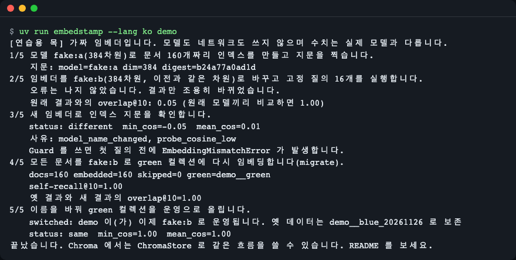
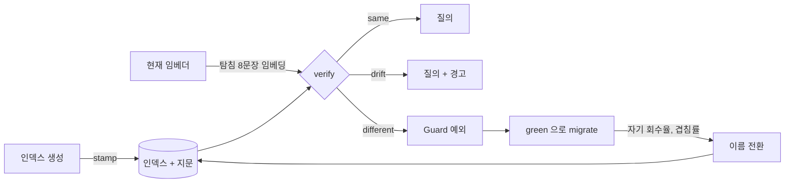
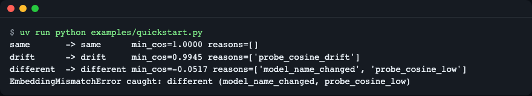
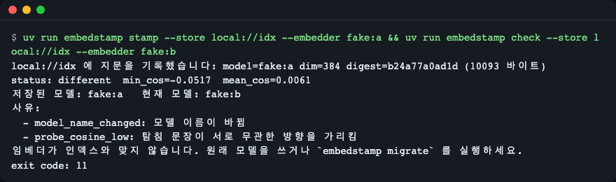

# embedstamp

[English](README.md) | **한국어**

벡터 인덱스에 임베딩 모델의 지문(모델 이름·차원·정규화 여부·고정 탐침 문장 8개의 벡터)을 찍어 둡니다. 나중에 질의할 임베더가 인덱스를 만든 그 모델인지 확인하고, 아니면 안전하게 다시 임베딩합니다. 순수 Python이고 필수 의존성은 `numpy` 하나이며, 어떤 저장소에도 쓸 수 있습니다(Chroma는 내장 지원).



*오프라인 연습용 데모(목 임베더)입니다. 명령 한 줄로 직접 돌려 볼 수 있습니다. [빠르게 시작하기](#빠르게-시작하기)를 보세요.*

## 왜 필요한가

RAG 인덱스 뒤의 임베딩 모델을 **같은 차원**의 다른 모델로 바꿔도 아무 오류가 나지 않습니다. 실험(Chroma 1.5.9, 문서 200개, 고정 질의 13개)에서 MiniLM으로 만든 인덱스를 bge 벡터로 질의하자 예외 없이 결과가 나왔고, 올바른 결과와의 top-10 겹침률은 평균 0.554, 최저 0.2로 떨어졌습니다(2026-11-27, 한 대의 기계에서 측정, 데이터에 따라 달라짐). 차원이 다를 때만 오류가 났습니다. 모델 이름만 보는 것도 충분하지 않습니다. 같은 모델에 질의 접두어만 붙여도 탐침 코사인이 0.903으로 움직였습니다.

embedstamp는 인덱스 옆에 작은 지문을 저장하고, 새로 만든 지문과 비교합니다.

| 판정 | 뜻 | 할 일 |
|---|---|---|
| `same` | 탐침 코사인 >= 0.999 | 계속 진행 |
| `drift` | 0.9 <= 최소 코사인 < 0.999 (양자화·접두어 변경 등), 또는 고정 항목(모델 이름·접두어·노름·정규화)이 바뀌었지만 코사인은 여전히 0.9 이상 | 질의는 되지만 결과가 달라질 수 있음 |
| `different` | 최소 탐침 코사인 < 0.9, 또는 차원·탐침 문장 집합이 바뀜 | 중단하거나 `migrate` |

임계값은 바꿀 수 있습니다(`Thresholds`). 이유 코드(`model_name_changed`, `probe_cosine_low` 등)가 왜 그런 판정인지 알려 줍니다. 모델 이름만 바뀐 경우는 `drift` 입니다. 막고 싶다면 `Guard(..., allow_drift=False)` 를 쓰세요.

## 설치

```bash
pip install embedstamp                 # 또는: uv add embedstamp
pip install "embedstamp[chroma]"       # Chroma 컬렉션 지원
pip install "embedstamp[fastembed]"    # fastembed 임베더 어댑터
```

아직 패키지 저장소에 없으면 GitHub에서 바로 설치합니다: `uv add git+https://github.com/LeeGyeongPil/embedstamp`.

Python 3.12 이상이 필요합니다(uv가 없다면 `curl -LsSf https://astral.sh/uv/install.sh | sh`). 런타임 의존성은 `numpy` 하나입니다. Chroma(`chromadb>=1.5.9`)와 `fastembed>=0.9.1`은 선택 extra입니다.

## 빠르게 시작하기

전체 흐름을 오프라인에서 명령 한 줄로 돌려 봅니다. 가짜 임베더("연습용 목 모드": 모델도 네트워크도 쓰지 않으므로 수치는 실제 모델과 다릅니다)를 씁니다.

```bash
git clone https://github.com/LeeGyeongPil/embedstamp && cd embedstamp
uv sync
uv run embedstamp --lang ko demo
```

```text
[연습용 목] 가짜 임베더입니다. 모델도 네트워크도 쓰지 않으며 수치는 실제 모델과 다릅니다.
1/5 모델 fake:a(384차원)로 문서 160개짜리 인덱스를 만들고 지문을 찍습니다.
    지문: model=fake:a dim=384 digest=b24a77a0ad1d
2/5 임베더를 fake:b(384차원, 이전과 같은 차원)로 바꾸고 고정 질의 16개를 실행합니다.
    오류는 나지 않았습니다. 결과만 조용히 바뀌었습니다.
    원래 결과와의 overlap@10: 0.05 (원래 모델끼리 비교하면 1.00)
3/5 새 임베더로 인덱스 지문을 확인합니다.
    status: different  min_cos=-0.05  mean_cos=0.01
    사유: model_name_changed, probe_cosine_low
    Guard 를 쓰면 첫 질의 전에 EmbeddingMismatchError 가 발생합니다.
4/5 모든 문서를 fake:b 로 green 컬렉션에 다시 임베딩합니다(migrate).
    docs=160 embedded=160 skipped=0 green=demo__green
    self-recall@10=1.00
    옛 결과와 새 결과의 overlap@10=1.00
5/5 이름을 바꿔 green 컬렉션을 운영으로 올립니다.
    switched: demo 이(가) 이제 fake:b 로 운영됩니다. 옛 데이터는 demo__blue_20261126 로 보존
    status: same  min_cos=1.00  mean_cos=1.00
끝났습니다. Chroma 에서는 ChromaStore 로 같은 흐름을 쓸 수 있습니다. README 를 보세요.
```

`demo__blue_20261126` 의 끝자리는 실행한 날의 UTC 날짜입니다(`<이름>__blue_<YYYYMMDD>`). 그래서 내 출력에는 내가 실행한 날짜가 찍히고, 현지 날짜와 다를 수 있습니다. 한국에서 2026-11-27 오전에 실행해도 `20261126` 이 찍힙니다.

위에는 서로 다른 겹침률이 두 번 나옵니다. 2단계는 옛 인덱스를 **새** 모델로 질의한 결과를 올바른 결과와 비교한 값입니다(0.05: 옛 인덱스에 엉뚱한 벡터를 댄 결과). 4단계는 "옛 모델 + 옛 인덱스"와 "새 모델 + 새로 임베딩한 green 인덱스"의 결과를 비교한 값입니다(여기서 1.00인 것은 목 `fake:b` 가 `fake:a` 와 같은 구조로 만들어졌기 때문이며, 실제 모델에서는 더 낮게 나옵니다. 그래서 이 값을 읽어 보는 것입니다).

내 코드에서는 6줄이면 됩니다.

```python
from embedstamp import FakeEmbedder, stamp, verify

old = FakeEmbedder("fake:a")           # stand-in for your real embedding function
fp = stamp(old, model="fake:a")        # stamp once, when you build the index
new = FakeEmbedder("fake:b")           # later: someone swaps the model (same 384 dims)
v = verify(fp, new, model="fake:b")
print(v.status, v.reasons)
```

```text
different ('model_name_changed', 'probe_cosine_low')
```

임베더는 `list[str]`을 받아 `(n, dim)` 모양의 배열을 돌려주는 호출 가능한 객체면 무엇이든 됩니다. `FakeEmbedder` 대신 내 함수나 `resolve_embedder("fastembed:BAAI/bge-small-en-v1.5")`를 쓰세요(`fastembed` extra 필요, 처음 쓸 때 모델을 내려받습니다. `examples/chroma_guard.py`의 두 모델은 약 167 MB).

## 핵심 개념



- **지문(Fingerprint)** — 모델 이름, 차원, dtype, 벡터 정규화 여부, 평균 노름, 접두어, 그리고 고정 탐침 문장 8개(영어·한국어·숫자·코드)의 벡터. JSON으로 저장하며 기본 약 10 KB(8 x 384), `compact=True`면 약 2 KB(32차원 요약, 덜 정밀)입니다.
- **탐침 코사인** — 같은 8문장을 다시 임베딩해 저장된 벡터와 비교합니다. 코사인의 최솟값이 `same` / `drift` / `different`를 정합니다. 코사인은 크기 변화를 못 보므로 평균 노름을 따로 기록합니다(`norm_changed`).
- **Guard** — 임베더를 감싸 한 번만 검사하고(결과는 캐시) 그다음에 임베딩합니다. 다른 모델이면 질의 전에 `EmbeddingMismatchError`를 내거나(`on_mismatch="warn"`이면 경고만) 합니다.
- **블루/그린 마이그레이션** — `migrate()`는 모든 문서를 새 green 컬렉션에 다시 임베딩하고 자기 회수율(self-recall@k)과 top-k 겹침률을 보고하며, 요청할 때만(`switch=True`) 이름을 전환합니다. 옛 데이터는 `<이름>__blue_<날짜>`로 남습니다. 중간에 실패해도 다시 실행하면 green에 이미 있는 id는 다시 임베딩하지 않습니다.

## API

| 이름 | 하는 일 | 주요 인자 | 반환 |
|---|---|---|---|
| `stamp(embed, ...)` | 탐침 문장을 임베딩해 지문을 만듦 | `model`(필수), `doc_prefix`, `query_prefix`, `probes`, `compact`, `extra` | `Fingerprint` |
| `verify(stored, embed, ...)` | 임베더를 저장된 지문과 비교 | `model`(필수), `doc_prefix`, `query_prefix`, `thresholds`, `probes` | `Verdict`(`status`, `min_cos`, `mean_cos`, `reasons`, `stored`, `current`, `compatible`) |
| `Thresholds` | 임계값 | `same=0.999`, `drift=0.9`, `norm_rel_tol=0.01` | 불변 dataclass |
| `Guard(store, embed, ...)` | 한 번 검사한 뒤 문서·질의 임베딩 | `model`(필수), `doc_prefix`, `query_prefix`, `on_mismatch="raise"\|"warn"`, `allow_drift=True`, `thresholds` | `check()`, `embed_documents(texts)`, `embed_query(text)` 를 가진 객체 |
| `migrate(source, new_embed, ...)` | 품질 보고가 있는 블루/그린 재임베딩 | `new_model`(필수), `target_name`, `old_embed`, `queries`, `k=10`, `batch_size=64`, `switch=False`, `min_self_recall=0.9`, `compact`, `progress` | `MigrationReport`(`n_docs`, `n_embedded`, `n_skipped`, `k`, `self_recall_at_k`, `overlap_at_k`, `green_name`, `built_name`, `blue_name`, `switched`, `status_after_switch`, `verdict_after_switch`, `fingerprint`, `seconds`). `built_name` 은 green 을 만든 이름(예: `docs__green`)이고, 전환하면 `green_name` 은 원래 이름이 됩니다. `verdict_after_switch` 는 전환 직후 다시 잰 `Verdict` 전체입니다(전환하지 않았으면 `None`). |
| `overlap_at_k(a, b, k)` | 두 top-k 목록의 공통 id 비율 | id 목록 두 개, `k` | `float` |
| `Fingerprint` | 저장되는 기록 | `to_json()`, `from_json(text)` | dataclass |
| `SidecarStore(path)` | 어떤 인덱스 옆에든 두는 JSON 파일 지문 | 파일 경로 | `load()`, `save(fp)` 를 가진 저장소 |
| `LocalIndex(path)` | 디렉터리에 두는 작은 전수 코사인 인덱스(데모·테스트·작은 말뭉치) | 디렉터리 | `add`, `query`, `count` 등과 마이그레이션을 지원하는 저장소 |
| `ChromaStore(collection)` / `ChromaStore.open(db_dir, name)` | Chroma 컬렉션 메타데이터 키 `embedstamp` 에 지문 저장, 다른 메타데이터 키는 보존(`hnsw:*` 키는 컬렉션 설정으로 옮겨감, [한계](#한계와-로드맵) 참고) | 컬렉션 또는 이미 있는 컬렉션의 경로 + 이름 | 마이그레이션 지원 저장소(extra `chroma`) |
| `FastEmbedEmbedder(model)` | fastembed 모델을 쓰는 임베더. `resolve_embedder("fastembed:<모델>")` 가 돌려주는 것 | fastembed 모델 이름 | 호출 가능 객체(extra `fastembed`) |
| `FakeEmbedder(model, dim=384, noise=0.0, scale=1.0, prefix="")` | 연습용 목 임베더 | 이름 참고 | 호출 가능 객체, `calls`·`texts_embedded` 집계 |
| `resolve_embedder(spec)` / `resolve_store(spec)` | 명세 문자열(`fake:a`, `fastembed:<모델>`, `local://dir`, `sidecar://file`, `chroma://db/collection`)을 객체로 | 명세 문자열 | `(embedder, model_name)` / 저장소 |

위 이름은 모두 최상위에서 가져올 수 있습니다(예: `from embedstamp import ChromaStore`). extra 가 필요한 두 이름은 처음 쓸 때 불러옵니다. `ChromaStore`(`embedstamp.stores.chroma` 에도 있음)는 `chroma`, `FastEmbedEmbedder`(`embedstamp.embedders.fastembed` 에도 있음)는 `fastembed` extra 가 필요합니다. extra 가 없으면 설치 명령을 알려 주는 `ImportError` 가 납니다. `import embedstamp` 만으로는 chromadb·fastembed 를 불러오지 않습니다.

예외(모두 `EmbedstampError`의 하위 클래스): `EmbeddingMismatchError`(`.verdict`), `FingerprintNotFoundError`, `FingerprintTooLargeError`, `SwitchRefusedError`(`.report`).

판정 이유 코드: `dim_changed`, `model_name_changed`, `doc_prefix_changed`, `query_prefix_changed`, `norm_changed`, `normalization_changed`, `probe_cosine_low`, `probe_cosine_drift`, `probe_set_changed`.

## 사용 예

### 1. same·drift·different 와 막힌 질의

`examples/quickstart.py`(오프라인):

```bash
uv run python examples/quickstart.py
```

```text
same       -> same      min_cos=1.0000 reasons=[]
drift      -> drift     min_cos=0.9945 reasons=['probe_cosine_drift']
different  -> different min_cos=-0.0517 reasons=['model_name_changed', 'probe_cosine_low']
EmbeddingMismatchError caught: different (model_name_changed, probe_cosine_low)
```



*임베더 세 개에 대한 세 판정, 그리고 `Guard`가 질의를 막습니다.*

### 2. Guard 를 붙인 Chroma 컬렉션

벡터를 직접 넣는(`embedding_function=None`) 경우로, Chroma 자체 설정 검사가 비교할 것이 없는 바로 그 상황입니다. `examples/chroma_guard.py --mock`(`chroma` extra 필요, clone 한 레포에서는 `uv run --extra chroma` 가 설치):

```bash
uv run --extra chroma python examples/chroma_guard.py --mock
```

```text
same model  : same
swapped model: EmbeddingMismatchError caught -> different ('model_name_changed', 'probe_cosine_low')
```

`--mock` 없이 실행하면 실제 fastembed 모델 두 개를 쓰며, 처음 실행 때 내려받습니다(약 167 MB, 멈추면 [문제 해결](#문제-해결) 참고). 먼저 extra 를 설치합니다.

```bash
uv sync --extra chroma --extra fastembed        # clone 한 레포에서
pip install "embedstamp[chroma,fastembed]"     # 내 프로젝트에서
uv run --extra chroma --extra fastembed python examples/chroma_guard.py
```

내 코드에서 쓰는 핵심 부분입니다. 벡터는 직접 넣고, 지문은 컬렉션 메타데이터에 저장하며, `Guard` 가 첫 질의 전에 검사합니다.

```python
import chromadb
from embedstamp import ChromaStore, FakeEmbedder, Guard, stamp

embed = FakeEmbedder("fake:a")
docs = ["Reset your password in settings.", "Invoices are due in thirty days."]

client = chromadb.PersistentClient(path="chroma_db")
collection = client.get_or_create_collection("docs", embedding_function=None)
collection.add(ids=["1", "2"], documents=docs, embeddings=embed(docs).tolist())

store = ChromaStore(collection)
store.save(stamp(embed, model="fake:a"))  # stamp once, when you build the collection

guard = Guard(store, embed, model="fake:a")
print(guard.check().status)
query_vector = guard.embed_query("forgot my login")  # raises if the model was swapped
print(query_vector.shape)
```

```text
same
(384,)
```

나중에는 `ChromaStore.open("chroma_db", "docs")` 로 같은 컬렉션을 다시 열거나, CLI 에 `--store chroma://chroma_db/docs` 로 지정할 수 있습니다.

### 3. green 컬렉션에 다시 임베딩하고 전환

`examples/migrate_local.py`(오프라인):

```bash
uv run python examples/migrate_local.py
```

```text
embedded=40 skipped=0 self_recall@10=1.00
switched=True status_after_switch=same
live model: fake:b
query ok: (384,)
```

자기 회수율이 `min_self_recall`보다 낮으면 `switch=True`는 거부됩니다(`SwitchRefusedError`, CLI 종료 코드 13). 먼저 `switch` 없이 돌려 보고서를 읽은 뒤 전환하세요.

### 4. 명령줄

clone 한 레포(빠르게 시작하기 흐름)에서는 `uv run embedstamp ...` 로 실행합니다. `pip install embedstamp` 로 설치했다면 `embedstamp` 명령이 PATH 에 있으므로 `uv run` 을 빼세요.

저장소 명세 아무 곳에나 stamp·check 를 합니다. 종료 코드로 스크립트가 결과를 알 수 있습니다(0 same, 10 drift, 11 different, 12 지문 없음, 13 전환 거부).

```bash
uv run embedstamp --lang ko stamp --store local://idx --embedder fake:a
uv run embedstamp --lang ko check --store local://idx --embedder fake:b
```

```text
local://idx 에 지문을 기록했습니다: model=fake:a dim=384 digest=b24a77a0ad1d (10093 바이트)
status: different  min_cos=-0.0517  mean_cos=0.0061
저장된 모델: fake:a   현재 모델: fake:b
사유:
  - model_name_changed: 모델 이름이 바뀜
  - probe_cosine_low: 탐침 문장이 서로 무관한 방향을 가리킴
임베더가 인덱스와 맞지 않습니다. 원래 모델을 쓰거나 `embedstamp migrate` 를 실행하세요.
```



*`different`면 `check`가 종료 코드 11을 돌려주므로 CI에서 실패시킬 수 있습니다.*

그 밖의 명령: `embedstamp show --store ...`는 저장된 지문을 출력하고(`--json` 가능), `embedstamp check ... --json`은 `status`·`min_cos`·`reasons`를 출력하며, `embedstamp migrate --store ... --to <임베더> [--from <옛 임베더>] [--queries 파일] [--switch]`는 블루/그린 흐름을 실행합니다. 모든 옵션은 `embedstamp <명령> --help`로 봅니다.

#### 명령줄로 마이그레이션하기

`migrate` 는 이미 문서가 들어 있는 인덱스의 문서를 옮깁니다. 위의 `stamp` 는 지문만 기록했으므로 `idx` 는 비어 있고, CLI 가 그렇게 알려 줍니다(종료 코드 1).

```bash
uv run embedstamp --lang ko migrate --store local://idx --to fake:b
```

```text
오류: local://idx 에 문서가 없어 다시 임베딩할 것이 없습니다. migrate 는 이미 있는 인덱스의 문서를 옮기는 명령이고, `embedstamp stamp` 는 지문만 기록하며 CLI 로는 문서를 넣을 수 없습니다. 먼저 쓰고 있는 벡터 저장소나 LocalIndex.add(...) 로 문서를 넣거나(examples/migrate_local.py 참고), --store 를 chroma://<db 디렉터리>/<컬렉션> 처럼 문서가 있는 인덱스로 지정하세요.
```

CLI 로는 문서를 넣을 수 없으니, 먼저 Python 으로 문서 30개짜리 작은 로컬 인덱스 `kb` 를 만듭니다(문서가 든 Chroma 컬렉션 `chroma://<db 디렉터리>/<컬렉션>` 도 똑같이 쓸 수 있습니다).

```bash
uv run python -c '
from embedstamp import FakeEmbedder, LocalIndex, stamp
docs = [f"document {i} about topic {i % 7}" for i in range(30)]
emb = FakeEmbedder("fake:a")
kb = LocalIndex("kb")
kb.add([f"d{i}" for i in range(30)], docs, emb(docs))
kb.save(stamp(emb, model="fake:a"))
'
```

그다음 전환 없이 green 에 다시 임베딩하고, 보고서를 읽은 뒤 전환합니다.

```bash
uv run embedstamp --lang ko migrate --store local://kb --to fake:b --from fake:a
uv run embedstamp --lang ko migrate --store local://kb --to fake:b --switch
uv run embedstamp --lang ko check --store local://kb --embedder fake:b
```

```text
local://kb 을(를) fake:b 로 다시 임베딩하는 중 ...
  문서 30/30
docs=30 embedded=30 skipped=0 green=kb__green
self-recall@10=1.00
옛 결과와 새 결과의 overlap@10=1.00
전환하지 않았습니다. kb__green 이(가) 준비됐습니다. 적용하려면 --switch 로 다시 실행하세요.
local://kb 을(를) fake:b 로 다시 임베딩하는 중 ...
  문서 30/30
docs=30 embedded=0 skipped=30 green=kb__green
kb__green 의 문서는 이전 실행에서 모두 임베딩돼 있어 다시 임베딩하지 않았습니다.
self-recall@10=1.00
switched: kb 이(가) 이제 fake:b 로 운영됩니다. 옛 데이터는 kb__blue_20261126 로 보존
status: same  min_cos=1.0000  mean_cos=1.0000
status: same  min_cos=1.0000  mean_cos=1.0000
저장된 모델: fake:b   현재 모델: fake:b
임베더가 인덱스와 일치합니다.
```

- 첫 실행은 `kb__green` 을 채우고 멈춥니다. `--from fake:a` 를 주면 옛 결과와 새 결과의 `overlap@10` 줄이 더해집니다.
- 두 번째 실행은 모든 문서가 이미 green 에 있음을 보고(`skipped=30`, `embedded=0`) 아무것도 다시 임베딩하지 않고, 자기 회수율을 다시 확인한 뒤 전환합니다. 마지막 줄은 전환 직후 잰 지문 검사 결과입니다.
- 이제 `kb` 는 `fake:b` 로 운영됩니다. 옛 데이터는 `kb__blue_<UTC 날짜>` 에 남으니 필요 없어지면 직접 지우세요.

## 설정과 언어

CLI 출력은 영어 또는 한국어입니다. 우선순위: `--lang en|ko` > `EMBEDSTAMP_LANG` > `LC_ALL` > `LC_MESSAGES` > `LANG`(`ko`로 시작하지 않으면 영어). 판정 코드와 라이브러리 예외 메시지는 항상 영어입니다.

| 변수 | 용도 |
|---|---|
| `EMBEDSTAMP_LANG` | CLI 언어 `en` 또는 `ko` |
| `FASTEMBED_CACHE_PATH` | fastembed가 내려받은 모델을 두는 위치 |
| `HF_HUB_OFFLINE=1` | 모델을 받은 뒤 오프라인 실행 |
| `HF_HUB_DISABLE_XET=1` | Xet CDN이 막힌 네트워크에서 모델 내려받기 |
| `EMBEDSTAMP_REAL=1` | 실제 fastembed 모델을 쓰는 테스트도 실행 |

## 언제 쓰나

- 나중에 다시 열 로컬·소규모 팀 RAG 인덱스, 에이전트 메모리, Chroma 컬렉션(그 사이 임베더 설정·라이브러리 버전·양자화가 달라질 수 있음).
- 벡터 데이터베이스와 무관하게 질의 전 검사, 측정 가능한 마이그레이션 보고서, 스크립트용 종료 코드가 필요할 때.
- 다른 도구가 나은 경우: Chroma의 임베딩 함수로 만든 컬렉션에서 Chroma 자체의 임베딩 함수 설정만 필요하다면 [Chroma 문서](https://docs.trychroma.com/docs/collections/configure)를 보세요. 호스팅 벡터 데이터베이스가 다시 임베딩을 대신해 주길 원하면 해당 데이터베이스의 마이그레이션 가이드([Qdrant](https://qdrant.tech/documentation/tutorials-operations/embedding-model-migration/), [Weaviate](https://docs.weaviate.io/weaviate/tutorials/vectorizer-migration) 등)를 보세요.

embedstamp는 문서 내용의 변화를 감지하지 않으며 평가를 대신하지도 않습니다. 탐침 코사인은 "같은 모델"임을 말해 줄 뿐 "검색이 좋다"는 뜻은 아닙니다.

## 문제 해결

| 증상 | 원인 | 해결 |
|---|---|---|
| `FingerprintNotFoundError` / CLI 종료 코드 12 | 인덱스에 지문을 찍은 적이 없음 | 어떤 모델로 만들었는지 아는 동안 `stamp(embed, model=...)` 후 `store.save(fp)` |
| 무해해 보이는 변경 뒤 `drift` | 양자화, 다른 런타임, 접두어 변경 | `reasons`를 확인하고, 변화를 감수할 때만 `Thresholds(drift=...)`를 낮춤 |
| 코사인은 1.0인데 `norm_changed` | 벡터 크기가 다름(정규화를 켜거나 끔) | 다시 임베딩하거나 같은 정규화 설정을 사용 |
| `FingerprintTooLargeError` | 저장소 메타데이터 한도가 지문보다 작음 | `stamp(..., compact=True)`(약 2 KB) |
| `ImportError: ChromaStore needs the optional dependency 'chromadb'` | `chroma` extra 없음 | `pip install "embedstamp[chroma]"`(clone 한 레포에서는 `uv sync --extra chroma`) |
| clone 한 레포에서 `examples/chroma_guard.py` 가 `ModuleNotFoundError: No module named 'chromadb'` | `uv sync` 는 코어만 설치하고, 이 예제는 `chromadb` 를 직접 import 함 | `uv run --extra chroma python examples/chroma_guard.py --mock` |
| `ImportError: FastEmbedEmbedder needs the optional dependency 'fastembed'`, 또는 `chroma_guard.py` 를 `--mock` 없이 실행하면 실패 | `fastembed` extra 없음(`uv sync` 만으로는 설치되지 않음) | `pip install "embedstamp[fastembed]"`(clone 한 레포에서는 `uv sync --extra fastembed`) |
| clone 한 레포에서 `embedstamp: command not found` | 명령이 프로젝트 가상환경 안에 있음 | `uv run embedstamp ...` |
| `migrate` 가 `문서가 없어 다시 임베딩할 것이 없습니다` 로 끝남(종료 코드 1) | 지문만 찍은 인덱스. `stamp` 는 문서를 넣지 않음 | 벡터 저장소나 `LocalIndex.add(...)` 로 문서를 넣거나, `--store` 를 문서가 있는 인덱스로 지정([명령줄로 마이그레이션하기](#명령줄로-마이그레이션하기) 참고) |
| 실제 모델 내려받기가 멈춤 | Xet CDN이 막힘 | `HF_HUB_DISABLE_XET=1` |

## 한계와 로드맵

- Chroma 컬렉션 전환은 이름 변경 2번이라 원자적이지 않습니다. 두 번째가 실패하면 `switch_to` 가 첫 번째를 되돌립니다.
- `ChromaStore` 가 지문을 저장한 뒤에는 `collection.metadata` 에서 `hnsw:*` 키가 보이지 않습니다. 거리 함수는 컬렉션 설정에 남습니다.
- 목 수치(`fake:a`, `fake:b`)는 실제 모델의 값과 다릅니다.
- 실제 fastembed 모델을 쓰는 테스트는 기본으로 건너뜁니다(`EMBEDSTAMP_REAL=1`).
- 예정: M2 에서 Qdrant, LanceDB, Ollama 임베더, 내용 해시 증분 재임베딩을, M3 에서 pgvector 와 LangChain / LlamaIndex 도우미를 추가합니다. 아직 없습니다.

## 관련 도구

- [vecdiff](https://pypi.org/project/vecdiff/) 는 두 인덱스 스냅샷을 사후에 비교합니다(이웃 안정성·통계). `migrate` 보고서와 보완 관계이며, 인덱스에 지문을 남기거나 질의를 막지는 않습니다.
- Chroma 의 [임베딩 함수 설정](https://docs.trychroma.com/docs/collections/configure) 은 다른 임베딩 함수 클래스를 주면 충돌 예외를 냅니다. 비교 기준은 클래스 이름뿐이고, 벡터를 직접 넣는 경우에는 비교할 것이 없습니다.
- LanceDB 의 [임베딩 레지스트리](https://docs.lancedb.com/embedding) 는 임베딩 함수를 테이블 스키마에 저장하며, LanceDB 전용입니다.

(2026-11-27 확인.)

## 버전·호환성

- [SemVer](https://semver.org/)를 따릅니다. 0.x 동안은 마이너 버전에서 API가 바뀔 수 있으며 바뀌면 [CHANGELOG.md](CHANGELOG.md)에 적습니다.
- 확인한 환경: Python 3.12, numpy 2.5.5, chromadb 1.5.9, fastembed 0.9.1(onnxruntime 1.32.0).
- 지문 JSON에는 앞으로의 변경을 위한 `schema` 필드가 있습니다.

## 개발·기여

```bash
uv sync
uv run pytest -q                    # 코어: numpy 만, Chroma 테스트는 건너뜀
uv run --extra chroma pytest -q     # 전체: Chroma 통합 테스트 포함
```

둘 다 실패 없이 끝나야 합니다. 실제 모델 테스트는 직접 요청할 때만 돕니다: `EMBEDSTAMP_REAL=1 uv run --extra fastembed pytest -q -m real`(처음 한 번 약 167 MB 내려받음).

CI 는 push·pull request 마다 core 잡을 돌려 core 테스트, `embedstamp demo`, quickstart 예제를 실행합니다. Chroma 테스트는 손으로 시작하는 별도 `extras` 잡에서 돕니다(Actions → ci → Run workflow).

## 라이선스

MIT.
