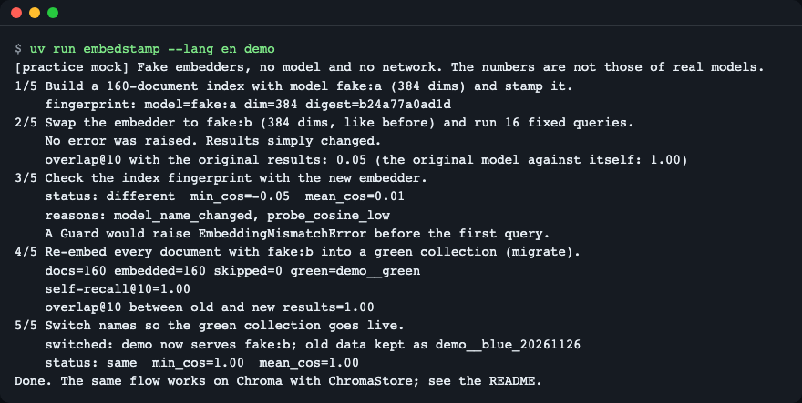
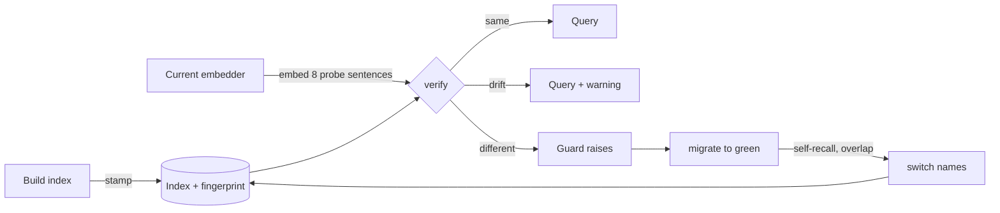
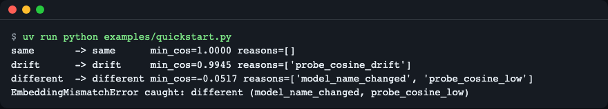
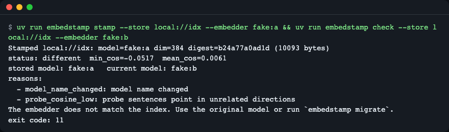

# embedstamp

**English** | [한국어](README.ko.md)

Stamp a vector index with its embedding model's fingerprint (name, dimension, normalisation, and the vectors of eight fixed probe sentences). Later, check whether the embedder you are about to query with is still the one that built the index, and re-embed safely when it is not. Pure Python, `numpy` is the only required dependency, and it works with any store (Chroma has built-in support).



*The offline practice demo (mock embedders). Run it yourself with one command, see [Quick start](#quick-start).*

## Why

If you replace the embedding model behind a RAG index with another model of the **same dimension**, nothing fails. In an experiment (Chroma 1.5.9, 200 documents, 13 fixed queries), querying a MiniLM-built index with bge vectors raised no error and the top-10 overlap with the right results fell to 0.554 on average and 0.2 at worst (2026-11-27, measured on one machine, results vary with the data). Only a different dimension raised an error. A model name check is not enough either: adding a query prefix to the same model moved the probe cosine to 0.903.

embedstamp stores a small fingerprint next to the index and compares a fresh one against it:

| status | meaning | what to do |
|---|---|---|
| `same` | probe cosine >= 0.999 | go on |
| `drift` | 0.9 <= min cosine < 0.999 (re-quantised, prefix changed), or a static field changed (model name, prefix, norm, normalisation) while the cosine is still >= 0.9 | queries work, results may shift |
| `different` | min probe cosine < 0.9, or the dimension or the probe set changed | stop, or `migrate` |

The thresholds are changeable (`Thresholds`). The reason codes (`model_name_changed`, `probe_cosine_low`, ...) say why. A rename alone is only `drift`; if you want it blocked, use `Guard(..., allow_drift=False)`.

## Install

```bash
pip install embedstamp                 # or: uv add embedstamp
pip install "embedstamp[chroma]"       # Chroma collection support
pip install "embedstamp[fastembed]"    # fastembed embedder adapter
```

Not on the package index yet? Install straight from GitHub: `uv add git+https://github.com/LeeGyeongPil/embedstamp`.

Requires Python 3.12+ (install uv with `curl -LsSf https://astral.sh/uv/install.sh | sh` if needed). One runtime dependency: `numpy`. Chroma (`chromadb>=1.5.9`) and `fastembed>=0.9.1` are optional extras.

## Quick start

Run the full flow offline in one command. It uses fake embedders (the "practice mock": no model, no network, so the numbers are not those of real models):

```bash
git clone https://github.com/LeeGyeongPil/embedstamp && cd embedstamp
uv sync
uv run embedstamp --lang en demo
```

```text
[practice mock] Fake embedders, no model and no network. The numbers are not those of real models.
1/5 Build a 160-document index with model fake:a (384 dims) and stamp it.
    fingerprint: model=fake:a dim=384 digest=b24a77a0ad1d
2/5 Swap the embedder to fake:b (384 dims, like before) and run 16 fixed queries.
    No error was raised. Results simply changed.
    overlap@10 with the original results: 0.05 (the original model against itself: 1.00)
3/5 Check the index fingerprint with the new embedder.
    status: different  min_cos=-0.05  mean_cos=0.01
    reasons: model_name_changed, probe_cosine_low
    A Guard would raise EmbeddingMismatchError before the first query.
4/5 Re-embed every document with fake:b into a green collection (migrate).
    docs=160 embedded=160 skipped=0 green=demo__green
    self-recall@10=1.00
    overlap@10 between old and new results=1.00
5/5 Switch names so the green collection goes live.
    switched: demo now serves fake:b; old data kept as demo__blue_20261126
    status: same  min_cos=1.00  mean_cos=1.00
Done. The same flow works on Chroma with ChromaStore; see the README.
```

The suffix of `demo__blue_20261126` is the UTC date of the run (`<name>__blue_<YYYYMMDD>`), so your output shows your own date. It can differ from your local calendar date: a run in Korea on the morning of 2026-11-27 still prints `20261126`.

Two different overlaps appear above. Step 2 compares the old index queried with the **new** model against the right results (0.05: wrong vectors against a stale index). Step 4 compares "old model on the old index" with "new model on the freshly re-embedded green index" (1.00 here only because the mock `fake:b` is built like `fake:a`; with real models it is lower, which is the point of reading that number).

The same idea in your own code, 6 lines:

```python
from embedstamp import FakeEmbedder, stamp, verify

old = FakeEmbedder("fake:a")           # stand-in for your real embedding function
fp = stamp(old, model="fake:a")        # stamp once, when you build the index
new = FakeEmbedder("fake:b")           # later: someone swaps the model (same 384 dims)
v = verify(fp, new, model="fake:b")
print(v.status, v.reasons)
```

```text
different ('model_name_changed', 'probe_cosine_low')
```

An embedder is any callable `list[str] -> array of shape (n, dim)`. Swap `FakeEmbedder` for your own function, or for `resolve_embedder("fastembed:BAAI/bge-small-en-v1.5")` (needs the `fastembed` extra; the first use downloads the model, about 167 MB for the two models used in `examples/chroma_guard.py`).

## Core concepts



- **Fingerprint** — model name, dimension, dtype, whether vectors are normalised, mean norm, prefixes, and the vectors of 8 fixed probe sentences (English, Korean, numbers, code). Stored as JSON: about 10 KB by default (8 x 384), about 2 KB with `compact=True` (a 32-dimension summary, less precise).
- **Probe cosine** — embed the same 8 sentences again and compare with the stored vectors. The minimum cosine decides `same` / `drift` / `different`. Cosine is blind to scaling, so the mean norm is recorded separately (`norm_changed`).
- **Guard** — wraps an embedder, checks once (the result is cached), and only then embeds. A different model raises `EmbeddingMismatchError` before the query runs, or just warns (`on_mismatch="warn"`).
- **Blue/green migration** — `migrate()` re-embeds every document into a new green collection, reports self-recall@k and top-k overlap, and switches names only when you ask (`switch=True`). The old data stays as `<name>__blue_<date>`. A crashed run can be repeated: ids already in green are not embedded again.

## API

| Name | What it does | Main arguments | Returns |
|---|---|---|---|
| `stamp(embed, ...)` | Embed the probe sentences and build the fingerprint | `model` (required), `doc_prefix`, `query_prefix`, `probes`, `compact`, `extra` | `Fingerprint` |
| `verify(stored, embed, ...)` | Compare an embedder with a stored fingerprint | `model` (required), `doc_prefix`, `query_prefix`, `thresholds`, `probes` | `Verdict` (`status`, `min_cos`, `mean_cos`, `reasons`, `stored`, `current`, `compatible`) |
| `Thresholds` | Cut-offs | `same=0.999`, `drift=0.9`, `norm_rel_tol=0.01` | frozen dataclass |
| `Guard(store, embed, ...)` | Check once, then embed documents or queries | `model` (required), `doc_prefix`, `query_prefix`, `on_mismatch="raise"\|"warn"`, `allow_drift=True`, `thresholds` | object with `check()`, `embed_documents(texts)`, `embed_query(text)` |
| `migrate(source, new_embed, ...)` | Blue/green re-embedding with a quality report | `new_model` (required), `target_name`, `old_embed`, `queries`, `k=10`, `batch_size=64`, `switch=False`, `min_self_recall=0.9`, `compact`, `progress` | `MigrationReport` (`n_docs`, `n_embedded`, `n_skipped`, `k`, `self_recall_at_k`, `overlap_at_k`, `green_name`, `built_name`, `blue_name`, `switched`, `status_after_switch`, `verdict_after_switch`, `fingerprint`, `seconds`). `built_name` is the name green was built under (for example `docs__green`); after a switch `green_name` becomes the original name. `verdict_after_switch` is the full `Verdict` measured right after the switch (`None` when not switched). |
| `overlap_at_k(a, b, k)` | Share of common ids in two top-k lists | two id lists, `k` | `float` |
| `Fingerprint` | The stored record | `to_json()`, `from_json(text)` | dataclass |
| `SidecarStore(path)` | Fingerprint in a JSON file next to any index | file path | store with `load()`, `save(fp)` |
| `LocalIndex(path)` | Small brute-force cosine index in a directory (demos, tests, small corpora) | directory | store with `add`, `query`, `count`, ... and migration support |
| `ChromaStore(collection)` / `ChromaStore.open(db_dir, name)` | Fingerprint in the Chroma collection metadata key `embedstamp`, other metadata keys are kept (`hnsw:*` keys move to the collection configuration, see [Limits](#limits-and-roadmap)) | collection or path + name of an existing collection | migratable store (extra `chroma`) |
| `FastEmbedEmbedder(model)` | Embedder backed by a fastembed model, what `resolve_embedder("fastembed:<model>")` returns | fastembed model name | callable (extra `fastembed`) |
| `FakeEmbedder(model, dim=384, noise=0.0, scale=1.0, prefix="")` | Practice-mock embedder | see names | callable, counts `calls`, `texts_embedded` |
| `resolve_embedder(spec)` / `resolve_store(spec)` | Turn spec strings (`fake:a`, `fastembed:<model>`, `local://dir`, `sidecar://file`, `chroma://db/collection`) into objects | spec string | `(embedder, model_name)` / store |

Every name above is importable from the top level, for example `from embedstamp import ChromaStore`. The two that need an extra are loaded only when you first use them: `ChromaStore` (also at `embedstamp.stores.chroma`) needs `chroma`, and `FastEmbedEmbedder` (also at `embedstamp.embedders.fastembed`) needs `fastembed`. Without the extra you get an `ImportError` that names the install command. `import embedstamp` alone never loads chromadb or fastembed.

Exceptions (all subclass `EmbedstampError`): `EmbeddingMismatchError` (has `.verdict`), `FingerprintNotFoundError`, `FingerprintTooLargeError`, `SwitchRefusedError` (has `.report`).

Verdict reason codes: `dim_changed`, `model_name_changed`, `doc_prefix_changed`, `query_prefix_changed`, `norm_changed`, `normalization_changed`, `probe_cosine_low`, `probe_cosine_drift`, `probe_set_changed`.

## Usage examples

### 1. Same, drift, different, and a blocked query

`examples/quickstart.py` (offline):

```bash
uv run python examples/quickstart.py
```

```text
same       -> same      min_cos=1.0000 reasons=[]
drift      -> drift     min_cos=0.9945 reasons=['probe_cosine_drift']
different  -> different min_cos=-0.0517 reasons=['model_name_changed', 'probe_cosine_low']
EmbeddingMismatchError caught: different (model_name_changed, probe_cosine_low)
```



*Three verdicts for three embedders, then `Guard` blocks the query.*

### 2. Chroma collection with a Guard

Vectors are added directly (`embedding_function=None`), which is exactly the case where Chroma's own configuration check has nothing to compare. `examples/chroma_guard.py --mock` (needs `chromadb`, which `uv sync` installs as a dev dependency):

```bash
uv run python examples/chroma_guard.py --mock
```

```text
same model  : same
swapped model: EmbeddingMismatchError caught -> different ('model_name_changed', 'probe_cosine_low')
```

Without `--mock` the script uses two real fastembed models and downloads them on the first run (about 167 MB, see [Troubleshooting](#troubleshooting) if it hangs). Install the extra first:

```bash
uv sync --extra fastembed                      # in a clone (chromadb is already a dev dependency)
pip install "embedstamp[chroma,fastembed]"     # in your own project
uv run python examples/chroma_guard.py
```

The core of it in your own code. Vectors go in directly, the fingerprint goes into the collection metadata, and the `Guard` checks before the first query:

```python
import chromadb
from embedstamp import ChromaStore, FakeEmbedder, Guard, stamp

embed = FakeEmbedder("fake:a")
docs = ["Reset your password in settings.", "Invoices are due in thirty days."]

client = chromadb.PersistentClient(path="chroma_db")
collection = client.get_or_create_collection("docs", embedding_function=None)
collection.add(ids=["1", "2"], documents=docs, embeddings=embed(docs).tolist())

store = ChromaStore(collection)
store.save(stamp(embed, model="fake:a"))  # stamp once, when you build the collection

guard = Guard(store, embed, model="fake:a")
print(guard.check().status)
query_vector = guard.embed_query("forgot my login")  # raises if the model was swapped
print(query_vector.shape)
```

```text
same
(384,)
```

Later you can reopen the same collection with `ChromaStore.open("chroma_db", "docs")`, or point the CLI at it with `--store chroma://chroma_db/docs`.

### 3. Re-embed into a green collection, then switch

`examples/migrate_local.py` (offline):

```bash
uv run python examples/migrate_local.py
```

```text
embedded=40 skipped=0 self_recall@10=1.00
switched=True status_after_switch=same
live model: fake:b
query ok: (384,)
```

`switch=True` is refused (`SwitchRefusedError`, exit code 13 in the CLI) when self-recall@k is below `min_self_recall`. Run without `switch` first, read the report, then switch.

### 4. The command line

In the cloned repository (the Quick start flow) run the CLI through `uv run embedstamp ...`. After `pip install embedstamp` the `embedstamp` command is on your PATH, so drop the `uv run`.

Stamp and check any store spec. The exit code tells scripts what happened (0 same, 10 drift, 11 different, 12 no fingerprint, 13 switch refused):

```bash
uv run embedstamp --lang en stamp --store local://idx --embedder fake:a
uv run embedstamp --lang en check --store local://idx --embedder fake:b
```

```text
Stamped local://idx: model=fake:a dim=384 digest=b24a77a0ad1d (10093 bytes)
status: different  min_cos=-0.0517  mean_cos=0.0061
stored model: fake:a   current model: fake:b
reasons:
  - model_name_changed: model name changed
  - probe_cosine_low: probe sentences point in unrelated directions
The embedder does not match the index. Use the original model or run `embedstamp migrate`.
```



*`check` returns exit code 11 for `different`, so a CI job can fail on it.*

More commands: `embedstamp show --store ...` prints the stored fingerprint (add `--json`), `embedstamp check ... --json` prints `status`, `min_cos`, `reasons`, and `embedstamp migrate --store ... --to <embedder> [--from <old embedder>] [--queries file] [--switch]` runs the blue/green flow. Run `embedstamp <command> --help` for every option.

#### Migrating from the command line

`migrate` moves the documents of an index that already has them. `stamp` above only wrote a fingerprint, so `idx` is empty and the CLI says so (exit code 1):

```bash
uv run embedstamp --lang en migrate --store local://idx --to fake:b
```

```text
error: local://idx has no documents, so there is nothing to re-embed. migrate copies the documents of an existing index; `embedstamp stamp` only writes the fingerprint and the CLI cannot add documents. Add them with your vector store or LocalIndex.add(...) first (see examples/migrate_local.py), or point --store at a filled index such as chroma://<db_dir>/<collection>.
```

The CLI cannot add documents. Fill a small local index `kb` with 30 documents in Python first (any filled Chroma collection, `chroma://<db_dir>/<collection>`, works the same way):

```bash
uv run python -c '
from embedstamp import FakeEmbedder, LocalIndex, stamp
docs = [f"document {i} about topic {i % 7}" for i in range(30)]
emb = FakeEmbedder("fake:a")
kb = LocalIndex("kb")
kb.add([f"d{i}" for i in range(30)], docs, emb(docs))
kb.save(stamp(emb, model="fake:a"))
'
```

Then re-embed into green without switching, read the report, and switch:

```bash
uv run embedstamp --lang en migrate --store local://kb --to fake:b --from fake:a
uv run embedstamp --lang en migrate --store local://kb --to fake:b --switch
uv run embedstamp --lang en check --store local://kb --embedder fake:b
```

```text
Re-embedding local://kb with fake:b ...
  30/30 documents
docs=30 embedded=30 skipped=0 green=kb__green
self-recall@10=1.00
overlap@10 between old and new results=1.00
Not switched; kb__green is ready. Re-run with --switch to make it live.
Re-embedding local://kb with fake:b ...
  30/30 documents
docs=30 embedded=0 skipped=30 green=kb__green
Every document was already in kb__green from an earlier run; nothing was re-embedded.
self-recall@10=1.00
switched: kb now serves fake:b; old data kept as kb__blue_20261126
status: same  min_cos=1.0000  mean_cos=1.0000
status: same  min_cos=1.0000  mean_cos=1.0000
stored model: fake:b   current model: fake:b
The embedder matches the index.
```

- The first run fills `kb__green` and stops. `--from fake:a` adds the old-versus-new `overlap@10` line.
- The second run finds every document already in green (`embedded=0 skipped=30`), so it re-embeds nothing, checks self-recall again and switches. The last line is the fingerprint check measured right after the switch.
- `kb` now serves `fake:b`. The old data stays in `kb__blue_<UTC date>`; delete it yourself when you no longer need it.

## Settings and language

CLI output is in English or Korean. Priority: `--lang en|ko` > `EMBEDSTAMP_LANG` > `LC_ALL` > `LC_MESSAGES` > `LANG` (anything that does not start with `ko` falls back to English). Verdict codes and library exception messages are always English.

| Variable | Used for |
|---|---|
| `EMBEDSTAMP_LANG` | CLI language `en` or `ko` |
| `FASTEMBED_CACHE_PATH` | Where fastembed keeps downloaded models |
| `HF_HUB_OFFLINE=1` | Run offline after the models are downloaded |
| `HF_HUB_DISABLE_XET=1` | Download models on networks that block the Xet CDN |
| `EMBEDSTAMP_REAL=1` | Also run the tests that use real fastembed models |

## When to use it

- A local or small-team RAG index, an agent memory, or a Chroma collection that you re-open later, possibly with a different embedder config, library version or quantisation.
- You want a pre-query check, a measurable migration report, and a scriptable exit code, independent of the vector database.
- Different tool is better when: you only need Chroma's own embedding-function configuration for collections created through its embedding functions (see the [Chroma docs](https://docs.trychroma.com/docs/collections/configure)); you need a hosted vector database to re-embed for you (see your database's own migration guide, for example [Qdrant](https://qdrant.tech/documentation/tutorials-operations/embedding-model-migration/) or [Weaviate](https://docs.weaviate.io/weaviate/tutorials/vectorizer-migration)).

embedstamp does not detect changes in your documents, and it does not replace evaluation: the probe cosine says "same model", not "good retrieval".

## Troubleshooting

| Symptom | Cause | Fix |
|---|---|---|
| `FingerprintNotFoundError` / CLI exit 12 | The index was never stamped | Stamp it while you still know which model built it: `stamp(embed, model=...)` then `store.save(fp)` |
| `drift` after a harmless change | Quantisation, a different runtime or a changed prefix | Check `reasons`; raise `Thresholds(drift=...)` only if you accept the shift |
| `norm_changed` although cosine is 1.0 | Vectors are scaled differently (normalisation switched on or off) | Re-embed, or use the same normalisation setting |
| `FingerprintTooLargeError` | The store's metadata limit is smaller than the fingerprint | `stamp(..., compact=True)` (about 2 KB) |
| `ImportError: ChromaStore needs the optional dependency 'chromadb'` | The `chroma` extra is missing | `pip install "embedstamp[chroma]"` (in a clone: `uv sync --extra chroma`) |
| `ImportError: FastEmbedEmbedder needs the optional dependency 'fastembed'`, or `chroma_guard.py` without `--mock` fails | The `fastembed` extra is missing (`uv sync` alone does not install it) | `pip install "embedstamp[fastembed]"` (in a clone: `uv sync --extra fastembed`) |
| `embedstamp: command not found` in a clone | The command lives in the project's virtual environment | `uv run embedstamp ...` |
| `migrate` says `has no documents, so there is nothing to re-embed` (exit 1) | The index was only stamped; `stamp` writes no documents | Add documents with your vector store or `LocalIndex.add(...)`, or point `--store` at a filled index (see [Migrating from the command line](#migrating-from-the-command-line)) |
| Real-model download hangs | Xet CDN is blocked | `HF_HUB_DISABLE_XET=1` |

## Limits and roadmap

- Switching a Chroma collection takes two renames, so it is not atomic. If the second one fails, `switch_to` rolls the first one back.
- After `ChromaStore` saves a fingerprint, the `hnsw:*` keys no longer show in `collection.metadata`; the distance function stays in the collection configuration.
- Mock numbers (`fake:a`, `fake:b`) are not those of real models.
- The test that uses real fastembed models is skipped by default (`EMBEDSTAMP_REAL=1`).
- Planned: M2 adds Qdrant, LanceDB, an Ollama embedder and content-hash incremental re-embedding; M3 adds pgvector and LangChain / LlamaIndex helpers. None of these exist yet.

## Related

- [vecdiff](https://pypi.org/project/vecdiff/) compares two index snapshots after the fact (neighbour stability, statistics). It complements the `migrate` report; it does not stamp an index or guard queries.
- Chroma's [embedding function configuration](https://docs.trychroma.com/docs/collections/configure) raises a conflict when a different embedding function class is passed. It compares the class name only, and it has nothing to compare when vectors are added directly.
- LanceDB's [embedding registry](https://docs.lancedb.com/embedding) stores the embedding function in the table schema, for LanceDB only.

(Checked 2026-11-27.)

## Version and compatibility

- Follows [SemVer](https://semver.org/). While 0.x, minor versions may change the API; changes are listed in [CHANGELOG.md](CHANGELOG.md).
- Tested with Python 3.12, numpy 2.5.5, chromadb 1.5.9, fastembed 0.9.1 (onnxruntime 1.32.0).
- The fingerprint JSON has a `schema` field for future changes.

## Development

```bash
uv sync
uv run pytest -q
```

```text
121 passed, 1 skipped
```

The skipped test uses real models; run it with `EMBEDSTAMP_REAL=1 uv run pytest -q -m real`.

## License

MIT.
